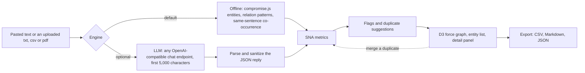

# Trapline — Entity Network Intelligence

**Paste text. Get a network. Nothing leaves your machine.**

**[Try it in your browser](https://bjharbison.github.io/trapline/)**: no install. The hosted copy runs the same single file, and analysis still happens entirely on your machine.

> Turn unstructured text into an interactive relationship graph for OSINT and investigative analysis — locally and privately, in your browser.


*Offline engine (the default), run on the fictional [investigative report](examples/investigative-report.txt). No model, no key, nothing sent anywhere.*

---

## Why Trapline is different

Most network-analysis tools assume you already know your starting point. Maltego, SpiderFoot, and similar tools pivot outward from a selector — a domain, an IP, a username — querying data sources to expand the picture. The newer text-to-graph tools work from prose instead, but they're built for engineers: stand up a database, run Docker, supply a cloud LLM key. Both approaches assume technical setup and a technical operator.

Trapline assumes neither. Open one HTML file, paste in an article or report, and you get an interactive relationship graph with the social-network metrics — degree, betweenness, closeness, PageRank — already calculated, so the key actors and the critical bridges between them are visible at a glance. There's no installation, no database, and no account. Extraction runs locally — using built-in offline analysis out of the box, or a local language model you point it at — so the source text never leaves your machine unless you choose to send it somewhere.

The point is to make link analysis usable without a link-analysis toolchain. If you can use a browser, you can map a network.

---

## Features

- **Two extraction engines, private by default** — built-in rule-based extraction (compromise.js) runs fully offline with no setup, no key, and no model download. For higher-quality results, point Trapline at a local model (Ollama, LM Studio, llama.cpp). If you choose to, you can instead use a cloud provider with your own API key: OpenAI, Anthropic (Claude), Google Gemini, OpenRouter, xAI (Grok), or any other OpenAI-compatible endpoint.
- **One-click model picker** — list the models actually installed on your LLM endpoint and choose from a dropdown, so you never have to remember exact tag names.
- **Paste or upload** — type/paste text directly, or load a `.txt`, `.csv`, or text-based `.pdf`. Files are parsed in your browser and never uploaded; scanned or image-only PDFs aren't supported yet (no OCR).
- **Interactive force-directed graph** — built on D3.js; node size reflects how central a node is, and confidence is shown visually.
- **Evidence on every link** — click a connection to see the sentence(s) it was extracted from, quoted from the text. In LLM mode the model's quote is kept only when it actually appears in the text; otherwise Trapline finds a sentence naming both entities, or says plainly that there is none. Evidence rides along into the CSV, GEXF, and Markdown exports.
- **Search the graph** — typing in the search box dims everything that doesn't match on the canvas as well as in the list; Enter zooms to the best match. The type filter works the same way.
- **Social network analysis, computed for you** — degree centrality, betweenness, closeness, eigenvector centrality, PageRank, and clustering coefficient, all calculated in-browser.
- **Cleanup tools** — flag anomalies, and detect and merge duplicate entities.
- **Edit entities** — fix what extraction got wrong: rename an entity, change its type, or delete it (with its connections) from the detail panel. Metrics, flags, and duplicate suggestions recompute after every edit. Renaming onto an existing entity's name (ignoring case and punctuation) is refused, never merged; when the Dupes tab can combine the two, the message says so.
- **Pin and arrange** — double-click nodes to pin them and lay the network out the way you want.
- **Exports** — CSV (nodes + edges, with SNA metrics), Obsidian-ready Markdown, raw JSON, and GEXF 1.3 for [Gephi](https://gephi.org/) (nodes carry type, confidence, mentions, description, and every SNA metric; edges carry the relationship label, strength as weight, and the evidence sentences).
- **Works on a phone** — the panel stacks above the graph, and every entity card has a ⋯ menu to pin, edit, or delete it without opening the detail panel.
- **Keyboard shortcuts** — press `?` for the full list: `/` to search, `F` to fit, `P` to pin, `E` to edit, `Esc` to close, `Ctrl+Enter` to analyse.

---

## Requirements

For the default offline mode, all you need is **a modern web browser** — that's it.

To use a language model for stronger extraction (optional), run a local OpenAI-compatible endpoint and point Trapline at it. For example, with [Ollama](https://ollama.com):

```bash
ollama pull qwen2.5:3b
```

Then set the endpoint to `http://localhost:11434/v1/chat/completions` in Trapline's config panel, click **List Models**, and pick `qwen2.5:3b` from the dropdown (or type a model name directly if your endpoint doesn't expose a list). LM Studio and llama.cpp work the same way.

**Using a cloud provider instead (optional).** Switch the engine to **LLM**, pick your provider from the **Provider** list, paste your API key, click **List Models**, and choose a model. The provider fills in the endpoint for you. **Custom OpenAI-compatible** takes any other endpoint that speaks the same format, such as your own vLLM server. Not sure how to get a key? Click the **?** next to the API key field for step-by-step instructions and a link to that provider's key page. Your key is used only for this tab and is not saved unless you tick **Keep key for this tab**, which keeps it through a refresh and forgets it when the tab closes. Your text is sent to that provider, and you pay its usage charges. The panel shows a warning whenever this is the case.

> **Model size and memory:** small models (4B or under) run slowly on CPU — expect roughly 30–120 seconds per analysis, with lower quality than a frontier model, but fully private. The model also has to fit in RAM: a 3B model such as `qwen2.5:3b` or `llama3.2:3b` needs about 2–3 GB, while `gemma3:4b` needs ~4 GB. Ollama gates loading on *free* memory, so on a small or busy machine a 4B model can refuse to load even when the OS reports plenty of reclaimable cache available — if you see a memory error, switch to a 3B model.
>
> **Remote endpoints:** if the model runs on another machine rather than `localhost`, that endpoint must accept cross-origin requests from a local file. For Ollama, set `OLLAMA_HOST=0.0.0.0` so it listens beyond localhost and `OLLAMA_ORIGINS=*` so it accepts the request, and reach it over a private network such as Tailscale rather than exposing the port to the internet.
>
> First load fetches D3.js, compromise.js, pdf.js, and the UI fonts from a CDN, then caches them. The text you analyze is never sent to those CDNs — see [Privacy](#privacy), or use the [fully offline build](#fully-offline-build) to skip the CDN entirely.

---

## Quick start

1. Download `trapline.html`.
2. Open it in your browser (double-click, or drag it into a browser window).
3. Paste your text into the input panel — or click **Upload** to load a `.txt`, `.csv`, or text-based `.pdf`.
4. Click **Analyse**. Entities and relationships populate the graph.
5. Explore, refine, and export.

That's the whole setup. No build step, no server, and — in offline mode — nothing to install at all.

Want something to try first? [`examples/`](examples/) has three short, fictional sample inputs: a news investigation, a threat-intel bulletin, and a sanctions notice.

---

### Fully offline build

The single file loads three libraries (D3, compromise.js, pdf.js) and two fonts from CDNs when it opens, so "offline" means the *analysis* is offline, not the first page load. For a machine with no internet at all, build a copy with everything inlined:

```bash
python3 build/offline.py        # writes trapline-offline.html (~2 MB), standard library only
```

It fetches the exact versions the page pins, from the same URLs, so the two builds never drift; pdf.js's worker is inlined too and handed over as a `blob:` URL. The fonts are dropped in favour of the system monospace. Copy the result anywhere — a USB stick, an air-gapped laptop — and double-click it. The built file is not committed (it is in `.gitignore`); rebuild it when the pinned versions change, or attach it to a release.

## Usage

- **Analyze text** — paste an article, report, or document (works best with 200–2000 words of continuous prose) and click Analyse.
- **Read the graph** — larger nodes are more central; use the SNA metrics to sort by betweenness or PageRank to find the actors that hold the network together.
- **Check a link** — click any connection on the canvas, or a row in an entity's Connections list, to read the sentence it came from before you rely on it.
- **Find a node** — type in the search box to dim everything else; press Enter to zoom to the best match. `?` shows every shortcut.
- **Refine** — review flagged anomalies, merge duplicate entities, and click an entity then ✎ (or its ⋯ menu in the list) to rename, retype, or delete it. A report's own publisher will show up as an entity when the text names it; delete it like any other.
- **Arrange** — double-click nodes to pin them in place.
- **Export** — send the network to CSV, Obsidian, JSON, or Gephi (GEXF) for downstream work.

---

## How it works

Everything below runs inside the page. The only network call Trapline makes with your text is the LLM request, and only when you choose that engine.



- **Input.** Uploaded files are read in the browser and never uploaded. CSV rows are turned into labelled sentences. PDFs go through pdf.js, which pulls out the text layer only.
- **Offline engine.** A cautious pronoun pass first: a sentence-initial *He* or *She* is replaced only when exactly one matching person was named in the sentence before. compromise.js then tags people, organizations, places and other noun phrases, and a few regexes add dates and capitalized names it missed. Relationships come from verb patterns such as *founded*, *works for* or *met with*. Entities named in the same sentence get a weaker co-occurrence link. Each link keeps the sentence(s) it was found in.
- **LLM engine.** The text goes to the endpoint in the config panel with a prompt asking for strict JSON. The reply is cleaned up before use: code fences are stripped, cut-off JSON is salvaged where possible, types and confidence values are limited to known values, and links to unknown entities or self-links are dropped. The model is asked to quote one sentence per link as evidence; a quote that is not in the text is discarded and replaced by a sentence naming both entities, if there is one.
- **Metrics.** Degree, betweenness, closeness, eigenvector, PageRank and clustering are computed in plain JavaScript. They are recomputed after every merge.
- **Review.** Flags point out likely brokers, isolated entities, low-confidence entities and graphs that are mostly co-occurrence. Duplicate suggestions are only suggestions. Nothing merges until you click Merge.
- **Display.** Extracted names, labels and evidence sentences are treated as untrusted and escaped before they reach the page.

---

## Privacy

Trapline is built to keep sensitive material on your machine. What leaves your device depends on which extraction engine you choose, plus one page-load request described at the end:

- **Offline mode (default):** rule-based extraction runs entirely in your browser. Your text goes nowhere.
- **Local LLM:** if you point Trapline at a model running on your own machine (Ollama, LM Studio, llama.cpp), your text goes only to that local endpoint and no further.
- **Remote LLM (your choice):** if you configure a remote provider (OpenAI, Anthropic, Gemini, OpenRouter, xAI, or your own server elsewhere), your text is sent to that provider. This is the only mode in which your text leaves your machine, and it only happens if you set it up. Whenever the endpoint isn't on your own machine, the config panel shows a warning naming the host your text will go to. That includes a model on another computer on your LAN or Tailscale network.
- **Stored settings:** your engine choice, endpoint URL, and model name are saved in the browser's `localStorage` for convenience. An API key, if you enter one, is used only for live requests and lives in the page only while the tab is open. If you tick **Keep key for this tab**, it is held in the browser's `sessionStorage` instead: it survives a refresh of that tab, is not visible to other tabs or to other websites, and is discarded when the tab closes. It is never written to `localStorage`. One caveat: when run from a local file, browsers give every `file://` page the same origin, so another local HTML file opened in that same tab could read the key. Close the tab when you're done.
- **Page load:** the standard `trapline.html` fetches D3.js, compromise.js, pdf.js, and two fonts from CDNs (jsDelivr, cdnjs, Google Fonts) the first time it opens, then caches them. Those CDNs see an ordinary page request — your IP address and that you loaded these libraries — and nothing else; your text is never sent to them. If even that is too much, the [fully offline build](#fully-offline-build) inlines everything and makes no network requests at all.

---

## Limitations

Trapline v1 is an honest proof-of-concept of the text → graph pipeline, not a finished analytic platform. Known limits:

- **Extraction is imperfect.** Offline mode uses pattern- and rule-based NLP (compromise.js) and will miss entities or relationships that don't fit its patterns; coreference resolution is heuristic and can mis-attribute pronouns. Verify findings against the source: the evidence on each link shows the sentence as it was analyzed, after pronoun resolution, so a wrongly resolved pronoun is visible there.
- **Small local models hallucinate.** A 3–4B model will occasionally invent entities or relationships not present in the text. Larger or remote models reduce this but don't eliminate it. A link with no evidence in LLM mode is a sign: the model asserted it without a sentence that supports it.
- **LLM input is capped at 5,000 characters.** In LLM mode, longer text is truncated to the first 5,000 characters (you'll see a warning). Offline mode reads the full text. The cap is lifted in v2's server-side pipeline.
- **Edits are not undoable and not saved.** Deleting an entity asks first but can't be reversed, and running Analyse again starts over from the text. Export to keep a cleaned-up network (Trapline cannot load an export back in yet). You can only merge entities that the Dupes tab groups together.

---

## Roadmap

Trapline ships in two stages:

- **v1 — single-file HTML (current):** self-contained, in-browser, local extraction. This is the shipping prototype.
- **v2 — Python + web frontend (next):** a proper rebuild with a FastAPI backend, real scraping, structured data-source plugins (Shodan, WiGLE, Censys, crt.sh), and `pip` / Docker distribution.

<!-- TODO: link to a fuller ROADMAP.md if you want to publish one -->

---

## Built with

- [D3.js](https://d3js.org/) — force-directed graph rendering
- [compromise.js](https://github.com/spencermountain/compromise) — offline rule-based NLP
- [pdf.js](https://mozilla.github.io/pdf.js/) — in-browser text extraction from PDF files
- Any OpenAI-compatible LLM backend (Ollama, LM Studio, llama.cpp, OpenAI) — optional, for higher-quality extraction

---

## License

Released under the [MIT License](LICENSE) — free to use, modify, and distribute, including commercially, with attribution.

---

## Disclaimer

Trapline is a tool for analyzing information you are authorized to collect and use. You are responsible for complying with applicable laws and the terms of service of any source you analyze. Automated extraction can be imperfect — verify findings before relying on them.
